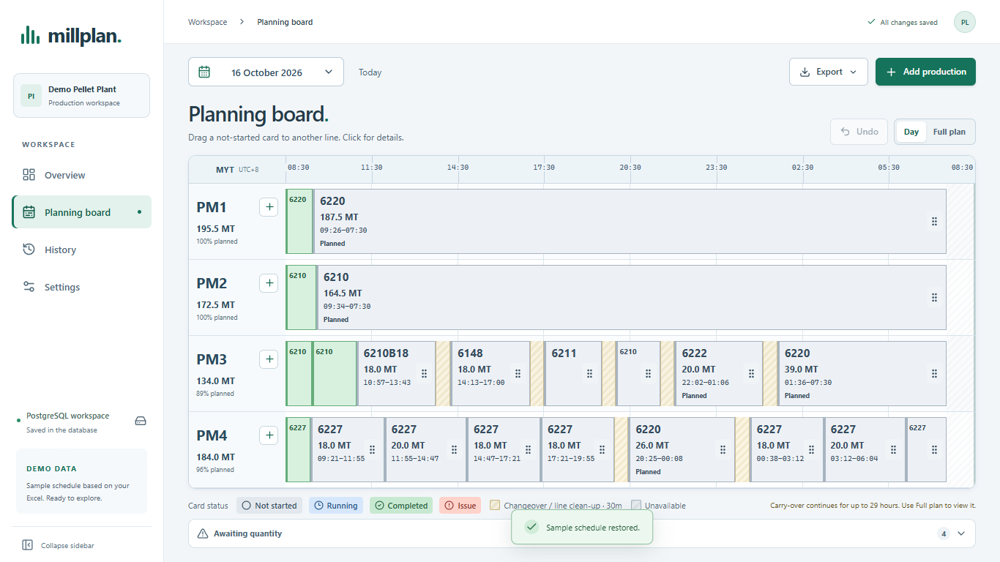

# Millplan · Pellet Planning Dashboard

A production planning dashboard for four pelleting lines, with a shared PostgreSQL workspace, movable production cards and Excel/PDF reports. Planners enter the required production manually; the dashboard calculates its sequence, duration and planned utilisation.

Built with React, TypeScript, Express and PostgreSQL 16. Docker Compose runs the application and database together.



## Start on Windows

Install and open **Docker Desktop** with Linux containers enabled, then double-click **`OPEN-DASHBOARD.cmd`** (or the equivalent **`START-DASHBOARD.cmd`**). Both launch the Docker application backed by PostgreSQL. The first launch builds the image and creates a private `.env` with a random database password. It may take a few minutes.

Open **[http://127.0.0.1:8080](http://127.0.0.1:8080)**. A new database starts empty. Add your first production, or explicitly load sample records in Settings → Reset demo.

To stop, double-click **`STOP-DASHBOARD.cmd`**. Stopping or rebuilding containers preserves the PostgreSQL volume. **Do not run `docker compose down -v` against data you need.**

Equivalent PowerShell commands:

```powershell
.\scripts\setup.ps1
docker compose up --build -d --wait
docker compose stop
```

The default setup serves only this PC. It has no login or user roles. Company-wide access needs authentication, TLS, restricted database credentials and an agreed backup owner before deployment. A public source repository does not publish the running dashboard or its database; GitHub Pages cannot run this backend.

## What it does

| Area | Features |
| --- | --- |
| Overview | Planned MT, utilisation, production load, completion, actual-output coverage, four line summaries, 24-hour status timelines and items needing attention |
| Planning board | Four horizontal lines; card length follows production time; Day/Full plan; carry-over; changeover and downtime; direct date/month/year selection |
| Card movement | Drag a pending card to another line or sequence; destination-bin review; recalculated line rate; one-step Undo; keyboard and held-touch movement |
| Production details | Add/edit in a dialog; searchable product catalog with description/default delivery; manual products; bags or bulk, orders, bins, remarks and issues |
| Copy planning | Select a source date/line/cards, enter fresh order references and adjusted quantities, preview target utilisation/carry-over, then append the batch atomically |
| Actual production | Manually enter actual start; Done asks for actual MT and records the server's end time; later output corrections retain the original timestamps |
| History | Combined date/line/status/search filters; totals across all matches, actual-output coverage; records and activity in pages of 50 |
| Reports | Daily or up to 31 days; optional line selection; numeric Excel output; A4 landscape print/Save as PDF |
| Settings and backup | Product catalog with deactivate/reactivate; calendar, rates, bag weight and downtime; version 2 JSON backup and legacy import; workspace recovery; PostgreSQL dumps |

Card colours: **gray** not started, **blue** running, **green** completed, **red** issue. Yellow stripes indicate changeover. Started/completed plans stay locked, and each line can have only one running production.

Database saves are confirmed before cards/forms show success. Concurrent stale changes keep the draft and require an explicit Reload latest before resubmitting. Uncertain saves keep the originating form open and offer Retry connection; retrying an acknowledged command cannot create a duplicate. Other changes refresh approximately every 15 seconds when no editor/details/settings draft is open.

## Historical demo records

For presentations, the administrator script can append explicitly fictional history to an existing **demo workspace**. Load the initial sample in Settings first if the workspace is empty. The script accepts up to 31 calendar days before today in Malaysia time, skips every date/line that already has records, preserves existing records and settings, and does nothing on a repeat import. It creates no automatic startup seed.

Preview from the project directory with Docker running:

```powershell
docker compose run --rm --no-deps `
  --volume "${PWD}/scripts:/app/scripts:ro" `
  --volume "${PWD}/src/domain:/app/src/domain:ro" `
  app node --import tsx scripts/seed-demo-history.ts `
  --dry-run --from 2026-09-20 --to 2026-10-19 --seed 20261020
```

After reviewing the counts and running `scripts/backup.ps1`, repeat with `--apply` in place of `--dry-run`. Import appends records in one revision-checked transaction and retains the preceding workspace as a recovery copy. It refuses non-demo workspaces. All generated products, orders, descriptions and activity are marked as fictional; they are not company or SAP records. A native development setup can use `npm run seed:demo-history --` with the same arguments and its private `DATABASE_URL`.

## Existing browser records

`OPEN-OFFLINE-DASHBOARD.cmd` opens the optional standalone **offline** `dist/index.html` after a build. It uses browser localStorage and the device clock. `OPEN-DASHBOARD.cmd` and `START-DASHBOARD.cmd` always start the HTTP application, which uses PostgreSQL and the server clock; these are separate workspaces.

To migrate: open the old offline dashboard in its original browser/path → Settings → Download backup. Open the database dashboard → Settings → Restore JSON backup → review → Replace workspace. This replaces rather than merges records, settings and activity. A copy of the preceding database workspace remains available for download after reload. Nothing is silently imported or seeded.

JSON version 2 includes the product catalog alongside records, settings and activity. Version 1 backups remain readable and restore an empty catalog; the import preview warns before replacement. Catalog changes affect future input only: saved production records retain their details. JSON does not contain command receipts or database migrations. Use PostgreSQL dumps for full database recovery.

## Planning assumptions

- Default rates in MT/hour: PM1 8.5, PM2 7.5, PM3 6.5, PM4 7.0; PM2 uses 6.5 for prefixes 6811 and 6542.
- Default bags are 50 kg. Production hours = MT ÷ applicable rate.
- A changed four-character product family adds 30 minutes of changeover by default.
- The default planning day begins at 08:30 with 23 available hours; confirm these settings with the planner.
- Downtime interrupts production/changeover and reduces availability. Work may carry into following days.
- Planned utilisation measures production inside the selected planning-day window divided by available time. It includes carry-over. Planned MT and report records are grouped by assigned planning date.
- Actual elapsed time includes stops; it is **not OEE**. Unknown actual MT remains blank, while known zero remains zero.
- Scheduling and display use Asia/Kuala_Lumpur, independently of the browser's time zone.

The optional sample reflects the original prototype's product families/quantities and configurable planning assumptions. Its order references, site, bins, statuses and actual results are illustrative, not an SAP import. No original workbook, company database, exported reports, credentials or local backups are committed.

## Development

Requires **Node.js 24.x**, npm and Docker. The Docker-only startup does not require Node on Windows.

```powershell
npm ci
.\scripts\setup.ps1
docker compose -f compose.yml -f compose.dev.yml up -d db --wait
npm run build
npm start
```

This runs the native API on port 8080, using PostgreSQL on loopback port 5434. In another terminal run `npm run dev` for Vite at [http://127.0.0.1:5178](http://127.0.0.1:5178). Its `/api` proxy targets port 8080. Keep the example `ALLOWED_ORIGINS` in `.env` for Vite. Stop the Docker **app** before running a native API on the same port. `npm run preview` previews assets only; use `npm start` for the complete built application.

On other operating systems, copy `.env.example` to `.env`, set a long random hex password and use that same password in `DATABASE_URL`, then run `docker compose up --build -d --wait`. Never commit `.env`.

## Verification

```powershell
npm test                  # domain, command, catalog, copy, backup, report and storage tests
npm run build             # frontend + server TypeScript and production HTML
npm audit --omit=dev      # deployed npm dependency audit
```

Real PostgreSQL API and browser suites require **disposable databases**. See [testing instructions](docs/TESTING.md). They cover persistence, concurrent revisions, rollback, retries, actual timestamps, reports and recovery. CI runs the unit, build, PostgreSQL API and browser suites.

## Handoff documentation

- [Architecture and database](docs/ARCHITECTURE.md)
- [Command API](docs/API.md)
- [Startup, backup, recovery and troubleshooting](docs/OPERATIONS.md)
- [Testing and verification](docs/TESTING.md)
- [中文操作说明](docs/USER_GUIDE.zh-CN.md)

The present scope is one shared workspace for a local pilot. SAP/stock reconciliation, automatic production-demand calculation, login/roles, named audit actors, scheduled backups and company-server deployment remain future work. No open-source licence is granted by this repository.
