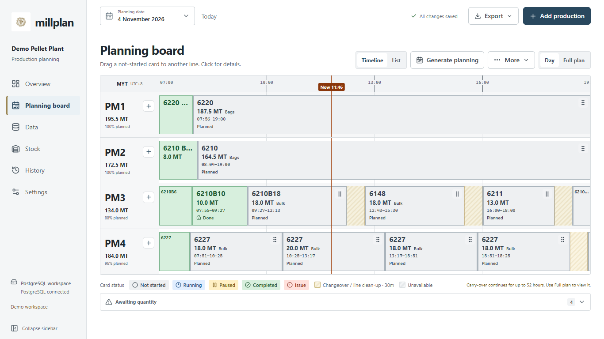

<p align="center">
  
</p>

<h1 align="center">Millplan</h1>

<p align="center">
  A pellet production planning dashboard that connects SAP Excel orders, finished-goods stock, and daily schedules across four pelleting lines.
</p>

<p align="center">
  
  
  
  
  
  <a href="https://github.com/shiebin-bit/pellet-planning-dashboard/actions/workflows/ci.yml"></a>
</p>

<p align="center">
  <a href="#dashboard-preview">Preview</a> ·
  <a href="#quick-start">Quick Start</a> ·
  <a href="#architecture">Architecture</a> ·
  <a href="#documentation">Documentation</a>
</p>

## Why This Project Exists

Daily pellet planning starts with customer orders exported from SAP, stock balances in Excel, and a decision about what each line should produce. Keeping those records in separate spreadsheets makes it harder to see capacity, follow an order across several production days, or distinguish completed production from collected goods.

Millplan brings those steps into one shared PostgreSQL workspace. Planners can import orders, check available stock, arrange production cards, record actual output, and follow each order through collection. Manual production entry remains available alongside stock-aware planning suggestions.

## Dashboard Preview



The desktop board shows PM1 to PM4 on one timeline. Card length follows planned duration, colours indicate status, and compatible orders can share one card with separate order quantities in its details. On phones, the board defaults to a per-line list; Timeline remains available.

The screenshot uses fictional demonstration records. Company workbooks, customer details, reports, backups, and credentials are excluded from this repository.

## What It Covers

| Workspace | Main responsibility |
| --- | --- |
| **Overview** | Daily planned quantity, within-shift plan, received stock, utilisation, order/stock priorities, and weekly line capacity |
| **Planning board** | Four-line Timeline/List, manual production, reviewed drag-and-drop movement, generated drafts, copy planning, and optional multi-order batches |
| **Orders** | Excel import previews, search and filters, order progress, partial collection, and a review queue for changed SAP records |
| **Stock** | Bags/bulk balances, reservations, available stock, safety-stock policies, daily movements, and physical-count adjustments |
| **History** | Production records and activity, combined filters, totals across all matching results, and 50-row pagination |
| **Settings** | Working calendar, line rates, changeover, unavailable periods, product catalog, stock policies, and backup/recovery |

Supporting workflows include:

- Due-date scheduling that respects stock reservations, unfinished production, line capacity, downtime, and existing cards.
- Editable planning drafts with split production across dates and lines, utilisation previews, late-order warnings, and browser-local draft recovery.
- Same-product order batches with per-order allocations; combining is optional and later-due batches can stay separate.
- Server-time Start and Done, partial production receipts, pause/resume with reasons, and auditable output corrections.
- Recorded-output progress and estimated finish when enough recent, reliable samples are available.
- Daily or date-range Excel reports and landscape print/Save as PDF, independent of list pagination.
- Revision-checked transactions, retry deduplication, retained drafts on conflicts, and before/after activity records.

## Daily Workflow

1. **Import orders.** Preview SAP Excel data and confirm new orders. Existing orders stay intact; differences enter a review queue for an explicit, reasoned correction.
2. **Check stock.** Reserve compatible finished goods and identify the remaining order shortage or Make for stock replenishment need.
3. **Plan production.** Generate a draft or add cards manually. Review quantities, dates, lines, order allocations, and capacity before saving.
4. **Record output.** Start at the current server time, post partial quantities as work progresses, and enter the final cumulative output when marking Done.
5. **Record collection.** Deduct only the quantity actually collected. Review order progress, stock movements, History, or export the required report.

### Business Rules

| Rule | Behaviour |
| --- | --- |
| Order identity | DO number + complete SAP material code; repeated imports add only unseen identities |
| Product display | A description such as `FS 5220 BROILER...` displays as `5220`; the complete material code remains the stored identity |
| Stock compatibility | Bags/bulk, bag weight, Medication, and FMR / OMED remain separate compatibility buckets |
| Quantity precision | Whole Bags with saved 25 kg/50 kg weights; bulk stock and allocations to 0.001 MT |
| Make for order | Produce the order shortage after compatible stock and unfinished production are considered |
| Make for stock | Meet order demand and replenish the configured safety-stock target; extra output is applied once before splitting |
| Production vs delivery | Done completes production; collection is recorded separately and may be partial |
| Working calendar | Default 07:00–19:00 in Asia/Kuala_Lumpur; editable hours, overtime, closures, overnight shifts, and carry-over |
| Historical records | Started/completed work retains its locked plan; imports do not invent production or collection movements |

For example, **30 available Bags against a 100-Bag order leaves 70 Bags to produce**. With a Make for stock target of 20 Bags, the total suggestion becomes **90 Bags** before any configured extra. See the [inventory workflow](docs/inventory-workflow.md) for reservations, daily balances, and workbook rules.

Planned utilisation describes scheduled capacity. Estimated finish uses recorded production samples; it is not a direct machine-sensor feed or measured OEE.

## Stack

| Layer | Technology |
| --- | --- |
| Frontend | React 19, TypeScript, Vite, Lucide icons, dnd-kit |
| Backend | Node.js 24, Express 5, shared TypeScript business rules |
| Database | PostgreSQL 16, SQL migrations, transactional commands |
| Import and reports | ExcelJS, browser print/Save as PDF |
| Testing | Vitest, Node test runner, Playwright, disposable PostgreSQL databases |
| Infrastructure | Docker Compose, GitHub Actions; optional Cloudflare Tunnel for remote access |

## Architecture

```text
Browser / React dashboard
          |
          | same-origin queries and revision-checked commands
          v
      Express API
          |
          +---- Shared TypeScript planning and inventory rules
          |
          v
     PostgreSQL 16
          |
          +---- Automatic V5 workspace snapshots
          +---- Full PostgreSQL dumps for database recovery
```

Docker serves the built dashboard and API together on port `8080`. PostgreSQL stays on the internal Compose network unless the optional loopback development port is enabled. Writes validate and save atomically; uncertain network retries reuse the original command ID.

Repository layout:

```text
pellet-planning-dashboard/
├── .github/workflows/    # CI
├── src/
│   ├── components/      # Shared UI, dialogs, and production details
│   ├── domain/          # Scheduling, commands, quantities, and reports
│   ├── lib/             # API, persistence, imports, and exports
│   └── pages/           # Dashboard workspaces
├── server/              # Express API, persistence, and backup service
├── migrations/          # PostgreSQL schema changes
├── tests/               # API and browser integration suites
├── scripts/             # Setup, startup, backups, and demo history
├── docs/                # User, developer, and operations guides
├── compose.yml
└── compose.dev.yml      # Optional localhost:5434 database access
```

## Current State

The application runs as a shared, persistent workspace with order imports, inventory tracking, reviewed scheduling, actual production, reporting, and recovery. A new database starts empty. Fictional demo records are loaded only through an explicit action.

The deployment model is a local Docker application. A configured Cloudflare Tunnel can route HTTPS traffic to it, but the host computer, Docker, and tunnel must remain running. GitHub Actions verifies the source; it does not automatically deploy this installation.

The application currently has no login, user roles, or named audit actors. Shared company access needs an authentication layer and an agreed backup owner. `ALLOWED_ORIGINS` controls accepted browser origins; it is not a login mechanism.

## Quick Start

### Windows with Docker Desktop

Install and open Docker Desktop with Linux containers enabled. From PowerShell:

```powershell
git clone https://github.com/shiebin-bit/pellet-planning-dashboard.git
cd pellet-planning-dashboard
.\scripts\setup.ps1
docker compose up --build -d --wait
```

Open **[http://127.0.0.1:8080](http://127.0.0.1:8080)**.

After cloning, you can also double-click **`OPEN-DASHBOARD.cmd`** or **`START-DASHBOARD.cmd`**. The setup script creates a private `.env` with a random database password and preserves an existing configuration. Docker-only startup does not require Node.js on Windows.

- Add your own production or import orders into the empty workspace.
- For fictional sample data, use **Settings → Backup & recovery → Reset demo**.
- Stop with **`STOP-DASHBOARD.cmd`** or `docker compose stop`.

Container replacement and normal stopping preserve the database volume. **`docker compose down -v` deletes that volume.**

On other operating systems, copy `.env.example` to `.env`, set a long random hex password, use the same password in `DATABASE_URL`, and run the Compose command above.

### Native Development

Requires Node.js **24.x**, npm, and Docker for PostgreSQL. Run from the repository root:

```powershell
npm ci
.\scripts\setup.ps1
docker compose stop app
docker compose -f compose.yml -f compose.dev.yml up -d db --wait
npm run build
npm run server:dev
```

In another terminal:

```powershell
npm run dev
```

| Service | Local address |
| --- | --- |
| Built dashboard and API | `http://127.0.0.1:8080` |
| Vite development UI | `http://127.0.0.1:5178`, with `/api` proxied to port `8080` |
| PostgreSQL for DataGrip/native development | `127.0.0.1:5434`, enabled by `compose.dev.yml` |

Keep the example Vite origins in `.env`. `npm run preview` previews assets only; `npm start` serves the complete built application. Avoid running the Docker app and native API on the same port.

### Configuration

| Variable | Purpose |
| --- | --- |
| `POSTGRES_DB`, `POSTGRES_USER`, `POSTGRES_PASSWORD` | Database identity and private credentials |
| `APP_PORT` | Docker application host port; defaults to `8080` |
| `DATABASE_URL` | Native API database connection; Compose supplies its own internal connection |
| `HOST`, `PORT` | Native API binding; setup uses `127.0.0.1:8080` |
| `ALLOWED_ORIGINS` | Exact permitted origins for development or a configured HTTPS reverse proxy |
| `AUTOMATIC_BACKUP_INTERVAL_HOURS` | Automatic snapshot interval; defaults to `24` |
| `AUTOMATIC_BACKUP_RETENTION_COUNT` | Managed successful snapshots retained; defaults to `14` |

Use [.env.example](.env.example) as the configuration reference. Keep `.env`, tunnel tokens, database dumps, and company data private.

## Testing

```powershell
npm test
npm run build
npm audit --omit=dev
```

For database and browser verification, **configure separate disposable databases and a test server first**. API tests truncate configured test tables, and browser mutation suites replace their selected workspace. Follow [Testing and verification](docs/TESTING.md); never point these suites at the active planning service.

```powershell
npm run test:api
npm run test:browser
```

Coverage includes scheduling, precise quantities, order batching, import reviews, reservations, partial production/collection, calendar changes, conflict handling, network retries, backup recovery, reports, and desktop/mobile interactions.

## CI

[Verify dashboard](.github/workflows/ci.yml) runs on pushes and pull requests with Node.js 24 and PostgreSQL 16. It installs the lockfile, runs unit and backup tests, builds the application, audits runtime dependencies, tests the API, and runs all 19 browser scripts using Playwright Chromium against a disposable database.

The badge above links to the current workflow status. Deployment is managed separately from CI.

## Backups and Data

- **Automatic recovery copies:** Docker saves portable V5 JSON snapshots to `backups/automatic/` every 24 hours by default, retaining 14 managed successful files. Settings shows last success, next attempt, and failures.
- **Manual workspace recovery:** Download or restore JSON in **Settings → Backup & recovery**. V5 includes orders, inventory movements, import reviews, and production progress. Older versions remain readable with warnings about omitted data.
- **Full database recovery:** Run `.\scripts\backup.ps1` for a PostgreSQL custom-format dump. Portable JSON does not include all database metadata or command receipts.
- **Restore behaviour:** Workspace restoration replaces the active workspace after preview and retains the preceding recovery copy. It does not merge records.
- **Browser drafts:** Saved generated drafts belong to that browser/origin and are outside database backups.

Keep protected copies outside the host disk and verify restores in a separate database. See the [operations guide](docs/OPERATIONS.md) for backup, recovery, update, and troubleshooting procedures.

The optional **`OPEN-OFFLINE-DASHBOARD.cmd`** opens the built, planning-only file workspace using localStorage and the device clock. It is separate from PostgreSQL and has no stock ledger. Export its JSON and explicitly restore it in the database dashboard to migrate records; nothing imports silently.

For presentation history, [seed-demo-history.ts](scripts/seed-demo-history.ts) accepts a bounded date range within the previous 31 Malaysia calendar days. It defaults to a dry run, requires a demo workspace, skips occupied date/line pairs, and uses `--apply` for an explicit import after backup.

## Documentation

- [Architecture and database](docs/ARCHITECTURE.md)
- [Command API](docs/API.md)
- [Startup, backup, recovery, and troubleshooting](docs/OPERATIONS.md)
- [Testing and verification](docs/TESTING.md)
- [Inventory and stock workflow](docs/inventory-workflow.md)
- [中文操作说明](docs/USER_GUIDE.zh-CN.md)

## Notes

- SAP integration currently uses Excel exports; there is no direct SAP API connection.
- Excel imports read data and cached formula results. They do not execute macros, formulas, or external links.
- Repeated imports retain existing orders and manual fields. Orders absent from a later workbook are not deleted or marked collected.
- The public repository contains source and fictional fixtures, not the running database or company files.
- No open-source licence is granted by this repository.
