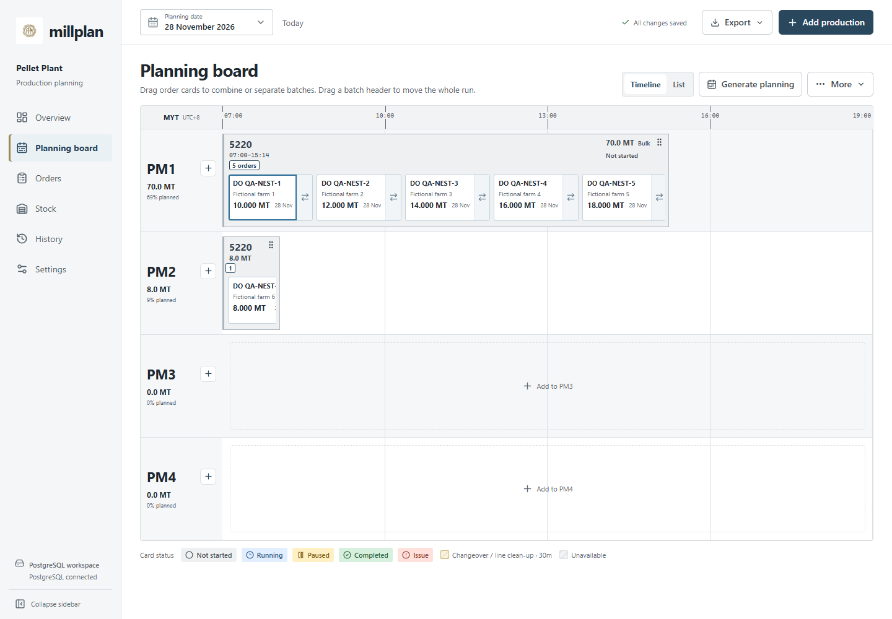
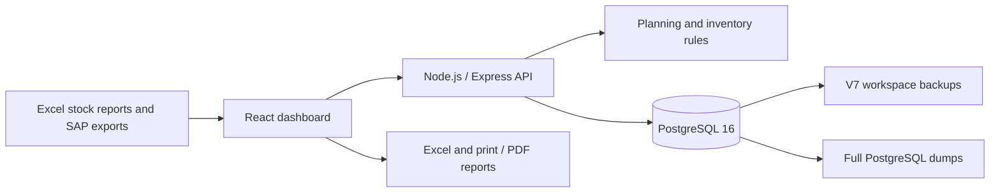

<p align="center">
  
</p>

<h1 align="center">Millplan</h1>

<p align="center">
  Stock-aware pellet production planning for PM1–PM4.<br>
  Import Excel orders, review production capacity, record output and track customer collection in one workspace.
</p>

<p align="center">
  
  
  
  
  
  <a href="https://github.com/shiebin-bit/pellet-planning-dashboard/actions/workflows/ci.yml"></a>
</p>

<p align="center">
  <a href="#preview">Preview</a> ·
  <a href="#features">Features</a> ·
  <a href="#quick-start">Quick Start</a> ·
  <a href="docs/USER_MANUAL.md">User Manual</a> ·
  <a href="#documentation">Documentation</a>
</p>

## About

Millplan connects the daily work that otherwise lives across SAP exports, stock spreadsheets and a manually maintained production schedule. Planners can see what is already available, what still needs production and how that work fits across four pelleting lines. Supervisors can record actual output and stops, while order progress continues through partial customer collection.

The Windows desktop application bundles the dashboard, its API and PostgreSQL 16. Install it once and open Millplan from the desktop or Start menu; no separate Node.js or database installation is needed. The same API remains independently runnable for future server deployment. A new installation starts empty; demonstration data is loaded only through an explicit action.

**Reviewed against the implementation: 27 November 2026.** For step-by-step operating instructions, see the **[English User Manual](docs/USER_MANUAL.md)**.

## Preview



The board offers Timeline and List views. Timeline shows each production run as a horizontal box containing individual order cards; its width follows planned duration. Grey, blue, yellow, green and red distinguish unstarted, running, paused, completed and issue states. On phones, planning defaults to a per-line list.

The image uses fictional demonstration records. This repository contains source code and test fixtures; company workbooks, customer records, backups and credentials are excluded.

## Features

| Page | Current capabilities |
| --- | --- |
| **Overview** | Daily planned quantity, within-shift plan, received stock, planned utilisation, daily line timeline, weekly capacity, priorities and recorded stops |
| **Planning board** | PM1–PM4 Timeline/List, draggable order allocations inside time-scaled batches, manual production, stock-aware drafts, reviewed whole-batch moves, combine/split, copy planning and browser draft recovery |
| **Orders** | Separate stock/SAP import modes, future order acceptance, search and filters, per-order production/collection journals, planning controls and import difference reviews |
| **Stock** | Separate Bags/Bulk balances, reservations and available quantities, MTO/MTS policies, safety stock, extra output, variant filters, Daily stock and physical-count adjustments |
| **History** | Production records and activity logs, date/PM/status/search filters, statistics across all matching records and 50-entry pagination |
| **Settings** | Working calendar, line rates and changeover, exact-product PM preferences, downtime and dated shift exceptions, product catalog, stock policies and backup/recovery |

### Planning cards and production records

- Plan an individual order or compatible same-product orders together, with a separate DO/customer/due-date/quantity breakdown inside the card.
- Optionally group same-product orders with the same due date during draft generation; later demand can remain in a separate batch.
- Move unstarted work after reviewing the affected schedule, utilisation, bin assignment and delivery risk.
- Moving an order or generated batch closes unused gaps on the affected PMs for today's and future plans. Working hours, downtime, recorded work and explicit start constraints still apply.
- Combine compatible unstarted cards on the same date and PM, or split orders/partial quantities across new cards while preserving every allocation and extra-stock total.
- In **Timeline**, drag an order into a compatible batch on any PM, or onto a PM label / empty line space to pull it out. Batch quantities, widths and schedules recalculate together; extra stock stays in the source batch. Narrow batches have a scrollable order strip and a **View orders** button. The arrow button offers the same move without dragging. Started, locked or output-recorded batches cannot transfer orders.
- Copy eligible manual cards to another date with new order references. Linked Excel-order cards are excluded to avoid duplicate demand.
- Start and finish at the current server time. Record incremental production receipts, pauses with reasons, issues and auditable corrections.
- Show recorded output and an estimated finish when enough recent, reliable samples exist. Progress is based on entered output; it is not a machine-sensor feed or measured OEE.

### Reports

Export the selected planning day to Excel or browser Print / Save as PDF. Date-range reports support up to 31 days and a selected PM or all four lines. Report scope is selected explicitly: History search/status filters and pagination do not restrict exports.

## Daily Workflow

1. **Establish or reconcile stock.** Review the latest dated stock report, or maintain the ledger through actual movements. The last count date is visible so old balances are not mistaken for a current physical count.
2. **Import future SAP orders.** Review the eligible date, packaging counts, exclusions and duplicates before confirming.
3. **Review demand.** Check reservations, shortages, held/cancelled orders and any import differences requiring attention.
4. **Prepare a plan.** Generate a reviewed draft or select orders manually. Continue unfinished work before new demand, then replenish applicable MTS targets.
5. **Record production.** Start the card, enter new receipts as output occurs and complete it with the final cumulative actual quantity.
6. **Record collection.** Deduct only what the customer actually takes, including partial collections. Review History or export the required report.

### Two Excel Import Modes

| | Baseline import | SAP orders |
| --- | --- | --- |
| Workbook source | Upper stock table on dated sheets such as 26th or 27th | `bag order` and `bulk order` |
| Purpose | Establish stock, retain daily stock reports and reconcile Closing differences | Accept new customer orders for the next production demand queue |
| Date rule | Detected stock-report date, reviewed before confirmation | **Goods Issue Date > server Malaysia today** |
| Existing records | Existing ledger movements remain; approved differences become adjustments | DO + complete Material code identifies duplicates; existing values remain unchanged |
| Excluded data | Lower order table, order Remark, Medication and FMR / OMED fields | Today, older and invalid/missing Issue Dates |

Re-imports do not automatically overwrite order quantities, dates, statuses or manual fields. Changed candidates enter the **Import review queue** for permitted, reasoned corrections. A row missing from a later workbook does not delete an order or mark it collected. If a preview crosses midnight, the server requires a new preview against the new eligible day.

Excel import reads saved data and cached formula results. It does not execute macros or recalculate workbooks. Recalculate and save edited formulas in Excel before importing.

### Stock and Order Rules

| Rule | Behaviour |
| --- | --- |
| Product identity | Complete SAP Material code remains the matching identity; the readable short label comes from the FS description and retains suffixes such as 5220M or 5220CCB |
| Stock compatibility | Bags/Bulk, saved bag weight and Medication / FMR / OMED variants are kept separate |
| Precision | Whole Bags; bulk inventory and order allocations to 0.001 MT; saved bag weight supports MT conversion |
| Available stock | On hand minus reserved stock |
| MTO | Produce the remaining order shortage after compatible stock and existing unreceived plans |
| MTS | Meet demand and replenish a numeric safety-stock target; PER ADVICE means MTO, and blank policies require confirmation |
| Extra output | Fixed or percentage extra is configured per stock product and applied once before splitting |
| Stock ready | Existing compatible stock covers the outstanding requirement; no new production is implied |
| Production complete | Production completion is recorded separately from customer collection |
| Collection | Each actual collection deducts stock once; full collection marks the order Delivered/OUT |
| Corrections | Original production, collection and adjustment records are retained with correction/reversal reasons |

**Example:** with 30 available Bags against a 100-Bag order, the production shortage is **70 Bags**. With a 20-Bag MTS target, the total suggestion is **90 Bags** before any additional configured extra.

Incremental production receipts use the card's native Bags/MT unit. **Mark as done** takes the final cumulative total in MT, including output already received; inventory-linked cards post only the difference. See the [manual's worked example](docs/USER_MANUAL.md#14-worked-example-and-glossary).

### Automatic Planning and PM Preferences

The default demand order is **work in progress → unfinished earlier accepted batches → new accepted batches → MTS replenishment**. Within a batch, the original acceptance order is retained. Stock-ready demand and quantities already covered by unfinished plans are not generated again. Held, cancelled and review-blocked orders are excluded.

Drafts distinguish **Continue**, **Carry over** and **New**. Overdue unstarted/unreceived work can be rescheduled using its original card. Started or partially received work stays on its original PM with only its remaining capacity reserved. Existing actual records remain; midnight alone does not move cards.

Default working hours are **07:00–19:00 MYT (Asia/Kuala_Lumpur)**. Available hours, rates, changeover, downtime and dated overtime/closure exceptions are configurable. The PM defaults below can be edited or disabled in **Settings → Production rules → Line preferences**.

| Exact product label | Packaging | Equally preferred lines |
| --- | --- | --- |
| 5220, 5220M | Bags | PM1 |
| 5220 | Bulk | PM1, PM4 |
| 5811, 5211 | Bags | PM2 |
| 5210 | Bags | PM2, PM3 |
| 5210 | Bulk | PM2 |
| 5222 | Bags | PM2, PM4 |
| Other combinations | As applicable | PM3 |

Demand priority and the earliest available date come before line preference. Same-day capacity can divert work to another PM. Preferences are exact matches, so 5220M, 5220MER and 5220CCB are not interchangeable. Changing rules affects regenerated drafts; it does not automatically move confirmed cards.

Current-day drafts leave a short review window and display **Confirm before**. Expired or stale drafts must be regenerated, with specific rejection reasons shown. **Save draft to this browser** is separate from confirming cards to PostgreSQL. For uncertain saves, retry/check the original request so it cannot create a second batch.

## Quick Start

### Windows Desktop

Run the **Millplan Setup** installer supplied with the release, then open **Millplan** from the desktop or Start menu. The application starts its own local PostgreSQL database and opens the planning workspace in a desktop window.

- Windows 10/11 x64; a normal user installation does not require administrator access.
- No separate Docker, Node.js, PostgreSQL or browser setup is required on the destination PC.
- Company orders and stock are **not** bundled in the installer. A fresh installation starts empty.
- Data and backups are stored separately under `%LOCALAPPDATA%\FFM\MillPlan`, surviving application updates and normal uninstall/reinstall.
- Closing the window keeps the application in the system tray. Use **Quit** to shut down the API and PostgreSQL safely.
- The local dashboard is also available at `http://127.0.0.1:8080` while the desktop app is running. PostgreSQL remains on `127.0.0.1:5434` for DataGrip.

For company rollout, copy the installer rather than this repository or your private data directory. To transfer a workspace, use an explicitly selected backup through Settings. For full database migration and recovery, see [Operations](docs/OPERATIONS.md).

### Build the Windows Installer

On a Windows development machine with **Node.js 24.x**, npm and the Visual Studio C++ x64 redistributable files (C++ Build Tools component):

```powershell
npm ci
npm run desktop:dist
```

The build downloads a pinned PostgreSQL Windows runtime and verifies its SHA-256 before packaging it. The installer contains the runtime, so the destination computer does not download PostgreSQL on first launch. Build outputs are ignored by Git. Local builds are unsigned unless signing credentials are supplied by the maintainer.

### Native Development

The web API remains available without Electron. Use an existing native PostgreSQL 16 database, copy [.env.example](.env.example) to a private `.env`, and set its connection URL:

```powershell
npm ci
npm run build
npm run server:dev
```

In a second terminal, run `npm run dev`. Use a dedicated development database; do not run mutation tests against the company workspace.

| Service | Address |
| --- | --- |
| Desktop / built dashboard and API | `http://127.0.0.1:8080` |
| Vite development UI | `http://127.0.0.1:5178`; `/api` proxies to port 8080 |
| Desktop PostgreSQL / DataGrip | `127.0.0.1:5434` |

Only one API may own port 8080. `npm run preview` previews frontend assets; `npm start` serves the built application and API. Desktop configuration is separate from the source checkout's `.env`.

## Architecture and Stack



| Layer | Implementation |
| --- | --- |
| Interface | React 19, TypeScript 5.9, Vite, Lucide, dnd-kit |
| API and rules | Node.js 24, Express 5, shared TypeScript domain rules |
| Persistence | PostgreSQL 16, SQL migrations, transaction/version checks and command retry deduplication |
| Workbook processing | ExcelJS; browser printing for PDF |
| Verification | Vitest, Node test runner, Playwright Chromium and isolated PostgreSQL databases |
| Deployment | Electron Windows installer with bundled PostgreSQL; standalone API for server deployment; optional Cloudflare Tunnel |

```text
pellet-planning-dashboard/
├── .github/workflows/   # Verification workflow
├── src/
│   ├── components/     # Dialogs, cards, inventory and shared interface
│   ├── domain/         # Scheduling, quantities, commands and reports
│   ├── lib/            # API clients, browser drafts and workbook handling
│   └── pages/          # Overview, Planning, Orders, Stock, History, Settings
├── server/
│   └── migrations/     # Database schema migrations
├── scripts/            # Setup, launch, database backup and demo-history tools
├── tests/              # API and browser integration tests
├── docs/               # User manual and technical documentation
└── desktop/            # Windows lifecycle, local PostgreSQL and installer configuration
```

### Configuration and Remote Access

Use [.env.example](.env.example) as the public reference; keep the real `.env` private.

| Configuration | Purpose |
| --- | --- |
| `POSTGRES_DB`, `POSTGRES_USER`, `POSTGRES_PASSWORD` | Database configuration; changing `.env` alone does not rotate an existing database role password |
| `PORT` | Standalone API port; default 8080, bound to loopback |
| `DATABASE_URL`, `HOST` | Standalone API connection and bind address |
| `ALLOWED_ORIGINS` | Exact additional browser origins for development or a configured HTTPS proxy |
| `AUTOMATIC_BACKUP_INTERVAL_HOURS`, `AUTOMATIC_BACKUP_RETENTION_COUNT` | Snapshot interval and retained successful copies; defaults 24 and 14 |

The desktop app manages its private configuration under `%LOCALAPPDATA%\FFM\MillPlan`. Both the API and PostgreSQL listen only on loopback; the source `.env` is used only for standalone server/development commands.

A configured Cloudflare Tunnel can route an HTTPS hostname to the local app. The host, desktop application (including its tray process) and connector must stay running. The application currently has **no built-in login, roles or named audit actors**; `ALLOWED_ORIGINS` is request validation, not access control. See [Cloudflare Tunnel](docs/OPERATIONS.md#cloudflare-tunnel) for proxy settings and restricted-access deployment.

## Backup and Recovery

| Backup | Contents and use |
| --- | --- |
| **V7 workspace JSON** | Planning, catalog, settings, orders, inventory/collection history, reviews, progress, accepted batches and continuation plans; download/restore through Settings |
| **Automatic snapshots** | The desktop API writes V7 JSON under the private data directory every 24 hours by default, retaining 14 managed successful copies; Settings displays status and failures |
| **PostgreSQL dump** | Full database recovery, including metadata and command receipts; run `.\scripts\backup.ps1` |
| **Browser-local draft** | Proposal stored in one browser/origin; outside database and workspace backups |

Workspace restoration previews then **replaces** the active workspace, retaining the preceding recovery copy; it does not merge records. Versions 1–6 remain readable with warnings for omitted data. Old orders without accepted-batch metadata do not automatically enter the new-demand queue.

Keep protected copies outside the host disk and verify restores in a separate database. The PostgreSQL data directory is persistent storage, not a backup. Recovery procedures are in [Operations](docs/OPERATIONS.md#backups).

The optional **OPEN-OFFLINE-DASHBOARD.cmd** uses a separate planning-only browser workspace with localStorage and the device clock. It has no PostgreSQL stock ledger. Migration requires an explicit backup/restore; records are not shared automatically.

## Verification

Basic checks:

```powershell
npm test
npm run build
npm audit --omit=dev
```

Database/browser tests require a disposable database and an isolated loopback test server. Follow [Testing and verification](docs/TESTING.md) before running `npm run test:api` or `npm run test:browser`: these suites can truncate or replace their configured test workspace and must never target company data.

[GitHub Actions](.github/workflows/ci.yml) runs on pushes and pull requests using Node.js 24 and PostgreSQL 16. It installs the lockfile, runs domain/dependency/backup tests, builds, audits runtime dependencies, exercises the API and runs the complete browser suite configured in [package.json](package.json). The badge links to the current result; CI verifies source and does not deploy the application.

Coverage includes stock-only and future-date imports, duplicates and reviews, precise quantities, MTO/MTS, multi-order allocation, card splits, carryover, PM preferences, calendar exceptions, actual output/collection, stale drafts, conflicts, retry safety, restore and responsive interactions.

## Documentation

| Guide | Audience and purpose |
| --- | --- |
| **[User Manual — English](docs/USER_MANUAL.md)** | Daily operators: feature explanations, step-by-step workflows, troubleshooting and worked example |
| [Inventory workflow](docs/inventory-workflow.md) | Detailed stock, import, reservation and scheduling rules |
| [Operations and handoff](docs/OPERATIONS.md) | Startup, configuration, tunnel, updates, backup and recovery |
| [Architecture](docs/ARCHITECTURE.md) | System boundaries and persistence design |
| [Command API](docs/API.md) | Queries, commands, validation and data contracts |
| [Testing and verification](docs/TESTING.md) | Isolated database and browser test setup |
| [Chinese operation notes](docs/USER_GUIDE.zh-CN.md) | Existing Chinese-language reference |

## Current Boundaries

- SAP integration uses Excel exports; there is no direct SAP API synchronisation.
- Stock accuracy depends on verified imports and recorded movements. A new day does not refresh stock or infer production/collection.
- Utilisation is planned capacity; output estimates depend on manual receipts and sufficient recent samples.
- Local installation and optional tunnel access require the host services to remain running. Company-wide deployment needs agreed access, backup and operating responsibilities.
- Company workbooks, customer data, private reports, backups and credentials must stay outside the public repository.
- No open-source licence is granted by this repository.
