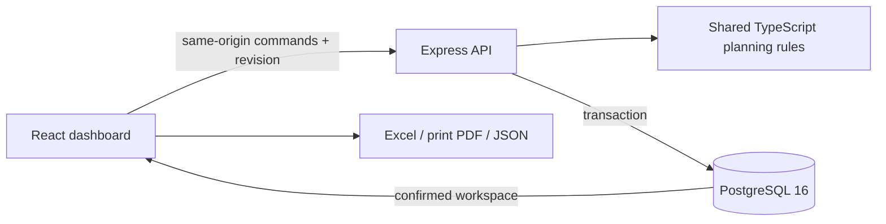

# Architecture

## Request flow

Docker serves the built dashboard and `/api` on the same port. PostgreSQL is internal to the Compose network. The native development setup adds a loopback-only database port and a Vite API proxy.

HTTP(S) always uses the API, even if browser records exist. Initial connection failure shows a reconnect screen. There is no fallback to a sample plan. The separate `file:` build preserves offline localStorage operation.

## Code map

| Location | Responsibility |
| --- | --- |
| `src/domain/engine.ts` | Scheduling, quantities, conflicts, state transitions and frozen tasks |
| `src/domain/commands.ts` | Typed commands, strict API parsing and shared command execution |
| `src/domain/backup.ts`, `reports.ts` | Workspace validation and report selection |
| `src/lib/workspace.tsx`, `api.ts` | Frontend persistence provider, revisions, drafts and request retries |
| `src/pages/`, `src/components/` | Overview, board, history, settings, dialogs and reports |
| `src/lib/export.ts` | Client-side Excel and JSON generation |
| `server/app.ts`, `index.ts` | HTTP boundary, static files, startup and shutdown |
| `server/store.ts` | Transactions, revision checks, command receipts and recovery |
| `server/migrate.ts`, `migrations/` | Numbered SQL migrations under an advisory lock |
| `scripts/`, `compose*.yml` | Local setup, containers and database backup |

## Data model

One workspace is supported. Domain backups remain `schemaVersion: 1`; database migration versions are independent.

| Table | Stored information |
| --- | --- |
| `workspace` | Singleton revision, settings JSONB, demo flag, previous workspace, Undo snapshot/revision and update time |
| `jobs` | Job ID, planning date, line, sequence, status, array order and complete job JSONB |
| `history_events` | Event ID, occurrence time, type, optional job ID, array order and complete event JSONB |
| `command_receipts` | Command ID, canonical content hash, applied revision and time |
| `schema_migrations` | Applied SQL migration versions |

Queryable columns have indexes and integrity checks against the corresponding JSON fields. A partial unique index allows only one running job per line. JSONB preserves compatibility with existing exports; some report fields still need JSON extraction rather than fully normalized SQL joins.

Do not edit tables directly: commands validate scheduling across lines/dates and keep projections, audit and revision synchronized.

## Write and retry guarantees

1. A mutation opens a transaction on one database client and locks the singleton workspace row.
2. An existing command receipt is checked before its expected revision. Identical content returns the current workspace without reapplying the action; conflicting content returns 409.
3. A new command must match the current revision. A stale action returns 409 plus the latest workspace and makes no change.
4. The server runs the shared planning rules and validates the complete resulting workspace. Completion uses the server's clock.
5. Jobs, history, metadata and receipt are persisted atomically; the revision advances once. Failure rolls the transaction back.

Reads use a repeatable-read, read-only transaction so metadata, jobs and history belong to one snapshot. Changes are serialized at workspace level, deliberately favouring simple correctness over concurrent independent line writes. This follows node-postgres' requirement that a transaction use the [same client throughout](https://node-postgres.com/features/transactions).

The browser waits for confirmation before accepting state. Network ambiguity retains the original command ID; a reconnect retries that ID. It does not guess whether the save succeeded. The originating surface stays open until confirmation. Background refresh pauses while an editor, details drawer or Settings is open to avoid updating the revision underneath a draft. A rejected stale action retains its draft but disables submission until an explicit Reload latest; an edit whose job was removed never becomes a create action.

## Recovery and audit

Restore and demo reset atomically retain the preceding workspace. Only one recovery snapshot is retained. Move Undo is held by the server and is valid only immediately after the most recent move; any other mutation invalidates it. Undo retains the move's activity and appends its own event.

The activity log has no authenticated actor and is replaced when a backup is restored. It is an operational history, not a compliance audit ledger. Full database dumps preserve receipts, recovery metadata and migrations as well as visible records.

## Current deployment limits

- No authentication, authorization, TLS, tenant separation or scheduled backup service. Host and Origin checks protect the loopback pilot boundary; they do not identify a user.
- The default Compose database account owns the database and runs migrations. Before a company deployment, separate a migration/owner role from a runtime role with only the required table privileges.
- Normal writes currently rebuild the job/history projections inside the transaction. Work is proportional to the total workspace, not only one card. This is for a small pilot; benchmark representative retained history before adoption and monitor latency. Consider incremental upserts/appends or archiving as history grows. Import limits are validation ceilings, not a performance guarantee.
- Command receipts have no automatic expiry. Keep them for reliable retry deduplication; a future retention policy must define how old retries are handled before deleting receipts.
- Reports run in the browser against the loaded workspace. There is no server-side report archive or SAP connector.
- Migrations run before HTTP starts. The health endpoint checks database connectivity, not a full domain-data integrity scan.

## Dependency status

The deployed dependency audit passed on 16 October 2026 with `npm audit --omit=dev`. ExcelJS uses a tested `uuid` override to avoid its older vulnerable transitive version.

The build-only `vite-plugin-singlefile → micromatch → braces` chain currently reports [GHSA-vfj7-8cjw-p6xm](https://github.com/advisories/GHSA-vfj7-8cjw-p6xm), a deeply nested pattern denial of service. The build uses fixed local patterns rather than user-supplied patterns; these packages are removed from the runtime image. Track an upstream fix or replace that build plugin. Do not use `npm audit fix --force` without reviewing its proposed plugin downgrade and rerunning the build/offline tests. Audits reflect their run date, not a permanent guarantee.
