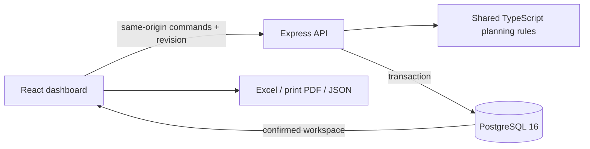

# Architecture

## Request flow

Docker serves the built dashboard and `/api` on the same port. PostgreSQL is internal to the Compose network. The native development setup adds a loopback-only database port and a Vite API proxy.

HTTP(S) always uses the API, even if browser records exist. Its in-memory loading state and a newly initialized database both start with default settings and no jobs or activity; initial connection failure shows a reconnect screen. There is no fallback to a sample plan. The separate `OPEN-OFFLINE-DASHBOARD.cmd` `file:` build preserves offline localStorage operation.

## Code map

| Location | Responsibility |
| --- | --- |
| `src/domain/engine.ts`, `defaults.ts` | Scheduling, quantities, conflicts, state transitions, frozen tasks and empty-workspace defaults |
| `src/domain/commands.ts` | Typed commands, strict API parsing and shared command execution |
| `src/domain/audit.ts`, `production-results.ts` | Normalized before/after snapshots and recorded pause-duration calculations |
| `src/domain/backup.ts`, `reports.ts` | Workspace validation and report selection |
| `src/lib/workspace.tsx`, `api.ts` | Frontend persistence provider, revisions, drafts and request retries |
| `src/pages/`, `src/components/` | Overview, board, Data, history, settings, dialogs and reports |
| `src/lib/export.ts` | Client-side Excel and JSON generation |
| `server/app.ts`, `index.ts` | HTTP boundary, static files, startup and shutdown |
| `server/store.ts` | Transactions, revision checks, command receipts and recovery |
| `server/migrate.ts`, `migrations/` | Numbered SQL migrations under an advisory lock |
| `scripts/`, `compose*.yml` | Local setup, containers and database backup |

## Data model

One workspace is supported. Domain backups use `schemaVersion: 2` with a top-level `catalog` array. Strict version 1 imports are normalized to version 2 with an empty catalog; legacy recovery and Undo snapshots are normalized on read. Database migration versions are independent.

| Table | Stored information |
| --- | --- |
| `workspace` | Singleton revision, settings JSONB, catalog JSONB (migration 003), demo flag, previous workspace, Undo snapshot/revision and update time |
| `jobs` | Job ID, planning date, line, sequence, status, array order and complete job JSONB |
| `history_events` | Event ID, occurrence time, type, optional job ID, array order and complete event JSONB |
| `command_receipts` | Command ID, canonical content hash, applied revision and time |
| `schema_migrations` | Applied SQL migration versions |

Queryable columns have indexes and integrity checks against the corresponding JSON fields. A partial unique index allows only one running job per line. JSONB preserves compatibility with existing exports; some report fields still need JSON extraction rather than fully normalized SQL joins.

Do not edit tables directly: commands validate scheduling across lines/dates and keep projections, audit and revision synchronized.

## Write and retry guarantees

1. A mutation opens a transaction on one database client and locks the singleton workspace row.
2. An existing command receipt is checked before its expected revision. Identical content returns the current workspace without reapplying the action; conflicting content returns 409.
3. A new command must match the current revision. A stale action returns 409 plus the latest workspace and makes no change.
4. The server runs the shared planning rules and validates the complete resulting workspace. Start, completion, pause and resume use the server's clock.
5. Jobs, history, metadata and receipt are persisted atomically; the revision advances once. Failure rolls the transaction back.

Reads use a repeatable-read, read-only transaction so metadata, jobs and history belong to one snapshot. Changes are serialized at workspace level, deliberately favouring simple correctness over concurrent independent line writes. This follows node-postgres' requirement that a transaction use the [same client throughout](https://node-postgres.com/features/transactions).

The browser waits for confirmation before accepting state. Network ambiguity retains the original command ID; a reconnect retries that ID. It does not guess whether the save succeeded. The originating surface stays open until confirmation. Background refresh pauses while an editor, copy dialog, details drawer or Settings is open to avoid updating the revision underneath a draft. A rejected stale action retains its draft but disables submission until explicit review; an edit whose job was removed never becomes a create action.

Catalog commands replace only `AppState.catalog`, independently of an unsaved Settings form. Production cards store product snapshots rather than catalog foreign keys. Copy validates at most 500 source selections before creating any new cards, preserves per-line source order and appends them after existing target work. It clears execution fields and recomputes with current production rules, then persists the entire batch, one activity entry and its receipt in the same transaction. Browser previews run the shared command in memory without writing to the API.

History filtering and totals run against the full loaded collection. Pagination slices only the displayed rows; report selection reads the full workspace independently. Activity has its own search/date filters and count because events do not all identify a production line or status.

## Recorded pauses

A paused production remains a running job with one open optional `pauseIntervals` entry. This retains the unique running-per-line constraint and frozen plan; it does not insert planned downtime or shift the schedule. Issue flags remain independent. Pause/resume commands use a trusted transaction timestamp; completion closes any open interval at its actual end. Ordered/non-overlapping validation also applies to restores, previous backups and Undo snapshots. Legacy records keep their absent fields rather than being rewritten.

`getProductionResult(job, asOfMs)` computes wall elapsed time and recorded pause time with an explicit snapshot clock when required. Net elapsed is wall elapsed minus recorded stops, not observed productive time. Selected-day downtime scans all job intervals and clips them to the business-day window, regardless of assigned planning date or locked planned segments. Totals across mills are line-minutes. Daily Excel stop rows use the same clipping; range reports list full intervals for jobs selected by planning date.

New events store bounded scalar `changes` snapshots derived from old/new persisted jobs, settings or catalog products. UI labels never resolve old values from current job data. Undo derives the reverse job diff. Causal settings changes are recorded without listing all dependent quantity recalculations; large list values use count/fingerprint summaries. Old events remain message-only. JSONB carries both additions without a migration or schema-version bump.

## Recovery and audit

Restore and demo reset atomically retain the preceding workspace. Only one recovery snapshot is retained. Move Undo is held by the server and is valid only immediately after the most recent move; any other mutation invalidates it. Undo retains the move's activity and appends its own event.

The activity log has no authenticated actor and is replaced when a backup is restored. It is an operational history, not a compliance audit ledger. Full database dumps preserve receipts, recovery metadata and migrations as well as visible records.

## Current deployment limits

- No authentication, authorization, TLS, tenant separation or scheduled backup service. Host and Origin checks protect the loopback pilot boundary; they do not identify a user.
- The default Compose database account owns the database and runs migrations. Before a company deployment, separate a migration/owner role from a runtime role with only the required table privileges.
- Normal writes upsert job rows and synchronize allocation/history projections inside the transaction. Work is proportional to the total workspace, not only one card. This is for a small pilot; benchmark representative retained history before adoption and monitor latency. Consider incremental upserts/appends or archiving as history grows. Import limits are validation ceilings, not a performance guarantee.
- Command receipts have no automatic expiry. Keep them for reliable retry deduplication; a future retention policy must define how old retries are handled before deleting receipts.
- Reports run in the browser against the loaded workspace. There is no server-side report archive or SAP connector.
- Migrations run before HTTP starts. The health endpoint checks database connectivity, not a full domain-data integrity scan.

## Dependency status

The deployed dependency audit passed on 16 October 2026 with `npm audit --omit=dev`. ExcelJS uses a tested `uuid` override to avoid its older vulnerable transitive version.

The build-only `vite-plugin-singlefile → micromatch → braces` chain currently reports [GHSA-vfj7-8cjw-p6xm](https://github.com/advisories/GHSA-vfj7-8cjw-p6xm), a deeply nested pattern denial of service. The build uses fixed local patterns rather than user-supplied patterns; these packages are removed from the runtime image. Track an upstream fix or replace that build plugin. Do not use `npm audit fix --force` without reviewing its proposed plugin downgrade and rerunning the build/offline tests. Audits reflect their run date, not a permanent guarantee.

## Excel source orders and calendar cutover

ExcelJS parses `.xlsx` in the browser; a shared normalized row contract is revalidated by the server. Import preview compares business keys (DO + material), then a revision-checked command stores the whole confirmed batch in one PostgreSQL transaction. `source_imports` retains provenance and as-of dates; `source_orders` has stable identity/delivery state; `source_order_versions` retains immutable imported payloads. Source data is queried independently of the 15-second planning workspace refresh. File formulas are not evaluated.

`jobs.source_order_id` projects the nullable link from the JSON payload. Multiple cards can fulfil an order. A combined card stores sourceAllocations in its JSON; job_source_allocations projects all order links for queries. Legacy singular links are backfilled into that projection without changing job JSON. Jobs retain source versions, quantity/code/customer/date snapshots and Bags weight snapshots. Repeat imports skip existing source identities entirely. Planning Undo excludes source tables. Restore/reset captures a full source recovery copy; portable backup v3 downloads source data on demand.

The calendar cutover command records its effective MYT date and prior calendar. Past pending tasks use that prior calendar for all segments, including overflow. Started/completed tasks use locked absolute segments; any legacy unlocked execution plan is frozen before cutover. Pending work allocates around locked segments and downtime and may delay later assigned dates. Validation rejects actual overlaps, not legitimate queue spill into another assigned day. Start uses the transaction's server timestamp and existing command receipts preserve that timestamp on retries.

## Editable working calendar

Ordinary `settings.update` changes to `dayStart` / `availableHours` create a server-managed effective-dated `calendarHistory` from the transaction's current MYT date. A null-date baseline plus ascending dated periods preserves prior assigned-day calendars. A later date appends a period; another change on the same date replaces that day's period. Top-level hours project the latest period. Client settings payloads cannot edit history. Legacy `calendarCutover` remains readable and is normalized only when hours change. No startup seed, SQL migration or production calendar change is performed by deploying this release.

The allocator resolves the effective calendar and per-line date exception for each future working window; it does not reuse the assigned date’s hours for all overflow segments. Started/paused/completed tasks keep absolute locked segments, including previously unlocked legacy execution plans frozen at the transition. New committed inventory drafts receive the server-owned `calendarManagedRelease` marker; only pending, unlocked, marked cards have their release floors rebased after a working-hours change. Manual/API constraints and unmarked older cards retain their original floors. Copies are unmarked; a combined card remains managed only when all members were managed, and retains the latest member floor. New drafts retain a release floor instead of a calculated slot start. Engine and generator share shift-window and business-day downtime intervals, including times after midnight. Draft edits and atomic confirmation validate against the saved shift rather than a fixed 19:00 cutoff. Revisions, command receipts and transaction rollback apply to calendar changes.

The optional history is included in current planning/version4 backups. Old backups without it still load. Older application binaries cannot read the new settings key after an hours change; recover with a current compatible build or the complete pre-change database backup.

## Planning review and browser drafts

`getOverviewMetrics` separates assigned-date quantities from the proportional share of scheduled production segments within a selected shift. Ledger-based production summaries are queried separately in a repeatable-read transaction and displayed only against the matching workspace revision. They use posting dates and immutable packaging snapshots rather than completed-card totals or current bag weights.

`previewMoveImpact` applies `moveJob` to an in-memory state, compares all scheduled ranges (including later assigned dates), checks protected execution data and evaluates current order deadlines. The modal captures its base revision, loads current due dates without modifying source snapshots, and blocks confirmation on a stale workspace. The server remains authoritative through the existing transaction and expected revision.

`usePlanningDraft` owns editable generated proposals separately from committed workspace state. Strict browser storage preserves one draft plus an optional exact pending command. Ordinary restores require matching revision/timestamp and non-past dates. Uncertain pending commands may be retried with the original receipt ID even after a revision change; no new batch is generated until that result is resolved. Other-tab edits are detected with storage events and best-effort compare checks, but localStorage cannot provide a truly atomic cross-tab transaction. Browser drafts are neither shared nor part of portable/database backup. No SQL migration is needed.

## Operational progress and reviewed source corrections

Migrations 012 and 013 add persistent source discrepancies, production-progress samples/resets and recovery columns. Startup does not create inventory movements, modify existing source versions or activate date hours. `Settings.workingHoursOverrides` is canonical per date/line with server-owned activation time and reason. The engine and generator resolve each future line window independently; the board uses the envelope of open line windows and shades closed intervals. Absolute started/completed segments remain protected.

Progress reads net production receipts and sample evidence in one repeatable-read snapshot. Server-created, receipt-command-linked samples are idempotent. Corrections retain original evidence and append resets; imported/Done quantities cannot manufacture throughput history. The shared frontend polls visible production, reconciles workspace revisions, marks retained stale quantities and hides stale estimates. It never changes quantities from a clock tick.

Discrepancies retain import provenance, observed source version, canonical candidate hash and resolution. Review commands run inside the existing workspace transaction/receipt boundary, lock the source/review, validate current protections and apply only explicitly selected fields with a reason. Duplicate imports never silently update existing orders. Source identity and execution snapshots remain immutable; quantity protections include reservations, pending/actual production and delivery. Backup v5 includes the queue and progress evidence; previous-workspace recovery carries the same graph.

Legacy started/completed jobs lacking locked segments are frozen only when their computed segments would change under the date exception. This preserves their effective schedule; unrelated execution payloads stay byte-identical. The single calendar activity event records the reason and affected date/lines.

## Weekly capacity and desktop lists

Planning reuses `ProductionList` across screen sizes. Desktop Timeline and mobile List remain the defaults; each device-class preference lives independently in the existing session navigation memory. List rows open the same drawer and Move workflow, without changing the scheduling or command contracts.

`getWeeklyCapacity` resolves the complete schedule once, then clips production/changeover segments to each line's own Monday–Sunday business shifts. Available intervals include date exceptions, calendar history and downtime. MT is proportional to production-segment duration, so carry-over is counted on the day where it occupies capacity. Load includes changeover; open time deducts only work within available intervals, while locked work outside availability raises a review signal. The weekly view and day drill-through do not write any jobs. Daily in-shift metrics use the same per-line shift boundaries.

## Automatic recovery copies

The single application process owns one optional automatic-backup service. It exports the existing repeatable-read portable V5 business graph, validates it and enforces the portable size limit before publishing a file. A private host bind mount survives application-container replacement independently of the database volume. Startup finds the newest valid managed snapshot, schedules the next24-hour interval or one immediate catch-up, and never replays every missed interval.

A single-flight job writes an exclusive temporary file, syncs/closes it and renames in the same directory. Managed-only retention runs after successful publication; export/write failures retain existing copies and schedule a15-minute retry. Shutdown cancels future timers and awaits the in-flight export before closing the database pool. `GET /api/backup/status` exposes sanitized operational metadata; it never exposes the absolute directory or raw errors. No SQL migration or workspace revision is involved. Multiple application replicas would require a shared scheduler/advisory-lock design before enabling this service on every replica. Portable copies intentionally remain separate from full `pg_dump` release/disaster-recovery backups.
