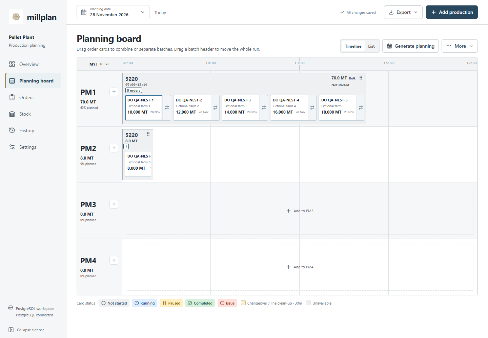

# Millplan User Manual

**Pellet production planning dashboard · English edition**  
**Last reviewed:** 27 November 2026

This manual is for planners, production supervisors and staff who maintain orders, finished-goods stock and production records. It covers the PostgreSQL dashboard used for daily operations. Installation and database maintenance are covered in the [operations guide](OPERATIONS.md).

Button names in **bold** match the English interface. All examples are fictional. A field's displayed unit always takes precedence over the examples in this manual.

## Contents

1. [Quick start and daily routine](#1-quick-start-and-daily-routine)
2. [Navigation and common controls](#2-navigation-and-common-controls)
3. [Overview](#3-overview)
4. [Import Excel files](#4-import-excel-files)
5. [Orders and customer collection](#5-orders-and-customer-collection)
6. [Stock and Daily stock](#6-stock-and-daily-stock)
7. [Create a production plan](#7-create-a-production-plan)
8. [Move, combine, split and copy cards](#8-move-combine-split-and-copy-cards)
9. [Record actual production](#9-record-actual-production)
10. [History and reports](#10-history-and-reports)
11. [Settings](#11-settings)
12. [Backup and recovery](#12-backup-and-recovery)
13. [Troubleshooting](#13-troubleshooting)
14. [Worked example and glossary](#14-worked-example-and-glossary)

## 1. Quick start and daily routine

### Open the dashboard

1. On the host computer, open Docker Desktop and wait for it to be ready.
2. Double-click **OPEN-DASHBOARD.cmd** or **START-DASHBOARD.cmd** in the application folder.
3. Open `http://127.0.0.1:8080` if the browser does not open automatically.
4. Check that the sidebar says **PostgreSQL workspace** and that there is no connection warning.

If your installation has a remote address, use the address supplied by the person maintaining it. The host computer, Docker and any configured tunnel must remain running. Changing from a local address to a remote address does not transfer browser-saved drafts.

Use **STOP-DASHBOARD.cmd** to stop the local services. Normal stopping preserves saved database records. Do not remove the database volume in Docker Desktop.

**OPEN-OFFLINE-DASHBOARD.cmd** opens a separate, browser-only planning workspace. It does not share the database or stock ledger. Use the PostgreSQL workspace for the workflows in this manual.

### Recommended daily routine

| Step | Action | Check before continuing |
| --- | --- | --- |
| 1 | Import the latest stock report when available, or record actual stock movements | The stock date and balances reflect the information you intend to use |
| 2 | Import SAP orders | Goods Issue Dates are from tomorrow onward in Malaysia |
| 3 | Review Orders and Stock | Check held/cancelled orders, import differences, reservations and shortages |
| 4 | Generate or manually create a plan | Review unfinished work, quantities, PM assignments, changeovers and completion dates |
| 5 | Confirm the plan | Wait for the save confirmation; a preview alone creates no cards |
| 6 | Start production and record output | Enter incremental receipts as production occurs; enter the final total when completing |
| 7 | Record customer collection | Deduct only the quantity actually collected |
| 8 | Review results and export reports | Check the report's dates and production line; maintain a backup copy |

On a new workspace, **establish stock first, then import future-dated SAP orders**. Generate planning requires a stock baseline. A stock-ready order is not a newly completed production job, and a completed production job is not a customer collection.

## 2. Navigation and common controls

| Page | Use it to |
| --- | --- |
| **Overview** | Review daily quantities, capacity, production status and items needing attention |
| **Planning board** | Arrange work across PM1–PM4 and open production cards |
| **Orders** | Import Excel, search orders, review changes, plan shortages and record collections |
| **Stock** | Check balances, reservations, policies, movements and daily stock |
| **History** | Review production records and activity, and prepare reports |
| **Settings** | Maintain working hours, production rules, products, stock policies and backups |

- The date selector on **Overview** and **Planning board** controls the planning day. Use **Today** to return to the current day.
- **Orders** has its own delivery-date filters. **Daily stock** has its own stock date. **History** filters planning dates or activity dates, depending on the selected tab.
- Open an order or **Manage stock** to view a dialog without scrolling back to the top of the page. Close the dialog to return to the list.
- On smaller screens, open the navigation menu to switch pages. Planning defaults to **List**; **Timeline** is still available.
- Wait while **Saving…** is displayed. **All changes saved** confirms that the current save has finished. An unsaved Settings form or browser-only draft still requires its own save action.

### Product identity and quantities

The large product label is read from the description: for example, `FS 5220 BROILER ...` displays as **5220**. Suffixes such as **5220M**, **5220MER** and **5220CCB** remain distinct. Expand the product details to inspect the complete SAP material code.

The short label is for readability. Order matching and inventory use the **complete material identity**, packaging, saved bag weight and applicable Medication / FMR / OMED variant. Two cards showing 5220 are not necessarily compatible.

- **Bags:** whole bags; check the product's 25 kg or 50 kg weight.
- **Bulk:** MT, with inventory quantities recorded to 0.001 MT.
- **Conversion:** `Bags × bag weight in kg ÷ 1,000 = MT`.

## 3. Overview

Use **Overview** to check the plan before opening individual cards.

| Metric | Meaning |
| --- | --- |
| **Daily planned quantity** | Whole batch quantities assigned to the selected planning date, including work continuing into later shifts; cancelled tasks are excluded |
| **Within-shift plan** | Estimated planned quantity inside the available working hours, including work carried from earlier days |
| **Received into stock** | Net production quantities posted into stock on the selected calendar date, including partial receipts and corrections |
| **Planned utilisation** | Scheduled production time within the planning window divided by available line time |

These figures answer different questions and do not have to match. Planned utilisation is a scheduling measure, not measured machine utilisation or OEE. Received into stock follows the posting date and is not a direct physical shift-output measurement.

In **Daily line schedule**, select a coloured product segment to open its production details. Use **Week capacity** to check the week's load, or **Open planning board** to edit the plan. Review the order/stock priorities, warnings, line capacity details, recorded stops and next-task list as needed.

## 4. Import Excel files

Open **Orders → Import Excel**. Choose the source before selecting the file. Importing reads workbook data and saved formula results; it does not run Excel macros or recalculate the workbook. If formulas have changed, recalculate and save the file in Excel before importing.

### 4.1 Choose the correct import type

| | Baseline import | SAP orders |
| --- | --- | --- |
| Source | Dated company worksheet, such as 26th or 27th | `bag order` and `bulk order` worksheets |
| Purpose | Import stock reports and reconcile balances | Add eligible new customer orders |
| Included | Upper stock table and daily stock movements | Orders whose Goods Issue Date is later than Malaysia today |
| Excluded | Lower order table, order Remark, Medication and FMR / OMED fields | Today, earlier dates and invalid/missing dates |
| Existing data | Stock differences require review; ledger entries are retained | Existing DO + complete material identities are retained without automatic overwrite |

### 4.2 Baseline import: stock only

1. Select **Baseline import** and choose the workbook or workbooks.
2. Review the detected report dates and stock rows. Multiple reports are reviewed in date order.
3. Select **Review baseline import**.
4. Expand **Ledger / Closing differences** if differences are reported. Compare each affected product and quantity against the workbook and existing movements.
5. If the reported Closing values are correct and should be applied, select **Reconcile the reported Closing and record the displayed differences as stock adjustments** and enter a clear reconciliation reason.
6. Select the acknowledgement confirming that you checked the report dates and differences, then select **Confirm baseline import** when enabled.
7. Check the imported stock in **Stock** and **Daily stock**.

For an empty ledger, the initial report establishes the stock position while retaining its available daily breakdown. When a ledger already exists, importing another report does not replay its production and issues as new transactions. Confirmed reconciliation creates adjustment entries; it does not erase earlier movements. Re-importing an identical report does not add the stock twice.

**A Closing difference is a request to investigate, not proof that the workbook is correct.** Check the report date, bag weight, compatibility variant, physical count and any production or collection already recorded. Do not approve an adjustment only to enable the button.

Baseline does not create orders or interpret DONE, OUT, HOLD or CANCEL in the lower table. It does not set order status or import manual order Medication / FMR / OMED fields.

### 4.3 SAP orders: future orders only

1. Select **SAP orders** and choose the SAP-export workbook.
2. Check the read-only earliest Issue Date. For example, importing on **27 November** accepts **28 November and all later** Goods Issue Dates.
3. Review the matching Bags/Bulk counts and the counts excluded for old, future or invalid dates.
4. If the standard sheets are not recognised, check the worksheet, header, date interpretation and column mapping. Manual mapping follows the same future-date restriction.
5. Select **Review import**. Check new records, retained duplicates, skipped differences and invalid rows.
6. Select the review acknowledgement and **Confirm import**.
7. Verify the new orders in **Orders**.

The server rechecks the date when saving. If midnight changes the eligible day after preview, keep the file selected and preview it again. No matching future orders means there is no batch to save.

### 4.4 Duplicate orders and changed SAP values

An order is identified by **DO number + complete Material code**. Re-importing an existing identity does not overwrite its quantity, date, status, manual fields, production or collection records. A missing row in a later workbook does not delete the order or mark it OUT.

Differences can enter **Import review queue**:

1. Open the review and compare **Current** against **Imported candidate**.
2. Select only the allowed fields you have verified, enter a reason and use **Apply selected fields**.
3. If the candidate should not be used, enter a reason and **Dismiss review**.

Protected fields cannot be overwritten. Existing reservations, planning, output or collection may prevent quantity changes. Review the business records instead of repeatedly importing the file to force a correction.

## 5. Orders and customer collection

Use the views **All orders**, **Needs production**, **Ready for pickup** and **Needs review**, together with search and the available date, packaging, status and import filters. Clear filters if an expected order is not visible.

Open the DO number to inspect the customer, full material, order quantity, inventory progress, associated production, import history and daily production/collection journal. Maintain Medication and FMR / OMED manually after checking the required variant.

### Read order progress correctly

| Field or status | Meaning |
| --- | --- |
| Reserved | Compatible on-hand stock set aside for this order |
| Produced | Recorded output allocated to the order; inspect the journal for dates and quantities |
| Collected | Quantity already recorded as taken by the customer |
| To plan | Remaining shortage after stock reservations and already scheduled, unreceived output |
| **Stock ready** | Existing stock covers the outstanding requirement; this does not claim new production occurred |
| **Planned / Running / Completed** | Production progress associated with the order |
| **Historically complete** | An earlier completion status is retained; it does not create a new production receipt |
| **Delivered / OUT** | Collection is complete |

Production and collection are separate. Stock-ready goods may still be uncollected. An order fully covered by stock or production should not be generated again simply because the customer has not collected it.

Delivery lead days indicates time remaining before the production deadline. **Days of outstanding** follows the workbook convention: the due date is day 1, the next day is day 2; earlier dates may be negative. Counting stops after full collection.

### Hold, cancel or correct a historical status

In order details, use **Planning control**, choose the appropriate action and enter a reason.

- **Hold** blocks new automatic planning while keeping stock reserved.
- **Cancel** blocks new planning and releases reservations; earlier production records remain.
- **Release** allows planning again after the status has been checked.
- Historical **DONE** records that production was already ready without inventing output or timestamps.
- Historical **OUT** is for a correction where the stock was already deducted. Use **Record collection** for a new physical collection.

Check associated production cards separately when holding or cancelling an order; do not assume that previously confirmed production has been removed.

### Record a customer collection

1. Open the order and find its stock/progress section.
2. Enter the **Collection date** and **Collected quantity** in the displayed unit.
3. Select **Record collection** and wait for confirmation.
4. Repeat for later collections. Enter only the additional quantity taken on each occasion.

Each collection deducts stock once. The system rejects excess collection or insufficient compatible stock. For an incorrect entry, use the supported reversal action in stock movements with a reason; do not enter another collection to compensate.

## 6. Stock and Daily stock

### Stock balances and policies

Open **Stock** and use search plus the packaging (**All packaging / Bags / Bulk**), strategy, variant and low-stock filters.

| Quantity | Meaning |
| --- | --- |
| On hand | Stock recorded in the ledger |
| Reserved | Part of on-hand stock allocated to orders |
| Available | On hand minus reserved |
| Safety stock | Configured target remaining after order requirements |
| Short | Replenishment shortage against the applicable safety-stock target |

Bags and bulk do not offset each other. Different bag weights or Medication / FMR / OMED variants do not automatically offset each other either. Do not assume that a large total balance is available for every variant.

- **Make for order (MTO):** produce for customer demand; workbook policy `PER ADVICE`.
- **Make for stock (MTS):** meet demand and replenish a numeric safety-stock target.
- **Unconfirmed policy:** a blank workbook policy needs checking; no automatic safety-stock replenishment is assumed.

Select **Manage stock** to open product policies and stock movements. Use **Save stock policy** for policy edits. The movement list shows the latest 100 entries; the complete ledger is retained in database backups.

### Daily stock and physical counts

1. Open **Daily stock** and select the stock date.
2. Filter the product/packaging as needed.
3. Review **Opening, Production, Received, Return, Rework, Issue, Adjustment and Closing**.
4. For a verified physical-count difference, select **Enter physical count**.
5. Check the product and variant, enter the actual counted quantity and a reason, inspect the calculated adjustment, then confirm.

Physical count is the total counted balance, whereas a manual adjustment is the signed change (+ or −). Use the field label to distinguish them. A count correction preserves the original ledger and adds the difference with its reason.

**Manage stock** also supports receiving from other sources, sales returns and rework deductions. Enter the date, movement type, quantity, correct variant and reason. Record normal card output through the production card so its order allocations stay connected.

The baseline/latest count date is a reference point, not an automatic live stock feed. Record subsequent production, collection and other movements, or reconcile to a newer verified count before relying on the balances.

## 7. Create a production plan

*Illustration: a four-line planning board. The screenshot contains fictional records; the live workspace may use different settings.*

### 7.1 Generate a stock-aware draft

1. Open **Generate planning** from Orders or Planning board.
2. Choose the demand range and planning dates. Check the existing schedule and stock position first.
3. Choose whether to **Combine same-product orders with the same due date**.
4. Generate the preview.
5. Review **Continue / Carry over / New**, quantities, dates, PMs, order allocations, extra stock, utilisation, estimated completion, late risks and **Unscheduled demand**.
6. Adjust editable quantities, dates or lines. Check that changes still meet the demand and available capacity.
7. Select **Confirm** before the displayed **Confirm before** time and wait for the save confirmation.

The planning order is **work in progress → unfinished earlier accepted batches → new accepted batches → MTS replenishment**. Orders within a batch keep their original acceptance order. Held, cancelled or review-blocked demand is excluded. Legacy orders without acceptance records do not automatically enter the new-demand queue.

The calculation considers compatible stock reservations and already planned, unreceived quantities. It uses line rates, working hours, changeovers, unavailable periods and line preferences. All four PMs can produce all products; preferences guide assignment rather than prohibit alternatives.

An overdue unstarted/unreceived card can be proposed for rescheduling with its original identity. Started or partially received work continues on its original PM with remaining capacity only. Actual records and historical locked times remain. Confirmation applies the proposed batch; midnight alone does not move cards or duplicate demand.

Some demand may not fit the selected range. Review **Unscheduled demand** and extend the range or adjust a permitted setting rather than assuming everything was scheduled. Unrelated confirmed future cards remain in place.

### 7.2 Draft deadlines, local saves and conflicts

Current-day proposals leave approximately 5–10 minutes for review before their earliest new start. If that start passes, **regenerate** using the remaining capacity. A draft is also invalidated by relevant workspace changes; do not force an old preview into a changed plan.

- **Save draft to this browser** saves a draft only in the current browser and address. It creates no production cards and is not included in database backups.
- **Resume saved draft** reloads that browser's saved draft. Another computer or address has a separate draft.
- **Confirm** saves production cards to PostgreSQL.
- For an uncertain network result, use **Retry connection** or **Check previous save** with the original request. Do not create a second batch while the first result is unresolved.
- A definite rejection preserves the draft and shows its reason/code. Review the latest workspace or regenerate as instructed.

### 7.3 Plan selected orders manually

Use **More → Plan from Orders** on Planning board, or **Plan production** in an eligible order's details. Search/select an order, then set the planning date, PM, quantity, bin and other required details. Use **Add same-product order** to include compatible orders in one batch, review their individual quantities and save.

This is useful when the supervisor wants to choose which due orders to run together. Matching product labels alone are not enough; complete product, packaging and variant compatibility still apply.

### 7.4 Add production without selecting an imported order

Select **Add production** or the **+ / Add** control beside a PM. Choose the date and line, select or type a product, and complete the quantity, packaging, bin, reference and notes required by the form. If the code matches an inventory product, check **Production purpose**, Medication and FMR / OMED. To associate an actual SAP order, use **Choose from order data**, which opens the order-planning workflow; typing a DO reference alone does not create that allocation.

Product search can fill the description from the catalog. Default packaging is applied only to a new entry before quantities are entered; it does not silently replace an existing card's packaging. Manual product entry remains available.

Before saving, check the calculated duration and any carry-over warning. Stock-linked output must retain the correct inventory product and variant; a free-text manual card is not a substitute for a verified stock item.

## 8. Move, combine, split and copy cards

| Action | How to use it | Important checks |
| --- | --- | --- |
| **Move** | Drag an unstarted card to another PM/position, or open **Move to another line or position → Apply move** | Review the before/after plan, affected tasks and risks, then **Confirm move**. Verify the destination bin after changing PM |
| **Combine** | Use **More → Combine cards**, or **Combine with other cards** in card details | Select compatible unstarted cards on the same planning date and PM; review due dates, total quantity and individual order allocations |
| **Split** | Open an eligible card → **Split card / quantities** | Divide orders or partial quantities between cards, dates and PMs; every order and extra-stock balance must have zero remaining |
| **Copy** | **More → Copy planning** | Select source/target dates, filter by PM, select cards, adjust quantities and enter new order references |

### Move individual orders inside the Timeline

Select **Planning board → Timeline**. Each PM has a horizontal lane; each production box follows the time axis and contains individual DO cards with customer, due date and allocated quantity. The frame width changes with the recalculated production duration. The previous standalone Batches choice now opens this integrated Timeline.

- Drag an order card onto a **PM label** or empty lane space to pull that allocation into its own production run at the end of that PM's schedule.
- Drag it into another compatible production box to combine that allocation with the destination's orders. Both batches must have the same planning date, full product identity, packaging, bag weight, Medication, FMR / OMED and production purpose. Matching short labels alone are insufficient; the PM may differ.
- Use the arrow button beside an order to select the PM and destination batch without dragging. This also supports keyboard operation.
- Drag the batch header to move the entire run through the existing schedule review.
- Scroll the order strip horizontally when a short batch cannot fit every card. Select its **order count** button to view all orders in a dialog and use their move arrows without scrolling the timeline.

An order move transfers its **whole allocation on that card**, which may be only part of its full order quantity. Use **Split card / quantities** for a partial allocation. Extra stock remains in the source box; if no orders or extra quantity remain, that box leaves the board and remains cancelled in History. No stock is produced or collected by moving orders.

Only unstarted, unlocked batches without recorded output are eligible. Orders on HOLD, CANCEL or pending review are blocked. Transfers save atomically and recalculate quantities and schedules; review the new finish times, delivery dates and destination bin after changing PM. Different due dates may be combined manually, so check every displayed due date. List remains available for a compact sequence view.

### Combine and split rules

A combined card retains an **Orders in this batch** breakdown with each DO, customer, due date and planned quantity. Production is posted once for the card, allocated in its order sequence; output beyond those allocations becomes compatible stock.

Combining is optional. You can run a near-due 5220 batch, then 5811, then a later 5220 batch. Automatic grouping combines compatible orders with the same due date rather than every order sharing the same short label.

Splitting preserves total quantities: move part of an order to another card without increasing its demand. The original card remains cancelled in History and new cards retain their source relationship. Split/combine does not itself receive stock. Started, output-recorded or locked work is not eligible for these operations. The **Combine cards** dialog requires the same date and PM; reposition whole cards first when needed. Individual order transfers in **Timeline** can cross PMs on the same date, subject to the compatibility checks above.

### Copy rules

Copy planning defaults to the previous day as source and the selected day as target. It copies **manual cards only**; linked Excel-order cards and cancelled cards are excluded to prevent duplicating order demand.

New order references are mandatory because copied references start blank. The copy retains product, packaging, bin, notes and relative line order, appending after existing target work. New cards are unstarted; actual results, pauses, problems, completion details and locked times are cleared. Review target utilisation and carry-over before saving. The original cards remain.

**Undo** is available for the most recent supported move; it is not a general undo for imports, production receipts or collections.

## 9. Record actual production

### Card colours

| Appearance | Meaning |
| --- | --- |
| Grey | Not started |
| Blue | Running |
| Yellow | Paused |
| Green | Completed |
| Red | Reported issue requiring attention |
| Hatched time block | Changeover/line clean-up or unavailable time; read its label |

An issue flag is separate from the underlying production status. Resolving an issue restores the existing state; it does not automatically complete the card.

### Start and record partial output

1. Open the production card and verify its product, quantity, PM, orders and bin.
2. Select **Start production** when production actually starts. The current server time is recorded automatically.
3. For an inventory-linked card, select **Record quantity** to focus the receipt input. Enter **New quantity** produced **in this entry** and its **Production date**, using the displayed Bags or MT unit.
4. Select **Record production quantity** and check **Production received into stock**. Repeat as additional output is produced.

Each saved receipt increases stock once and updates the related order progress. Do not post the same physical production again as a separate receiving adjustment.

### Pause, resume and report an issue

Use **Pause production**, enter a reason and **Confirm pause** when production stops. Use **Resume production** when it resumes. Recorded stops are retained; elapsed time includes stops, while elapsed minus recorded stops excludes only those entered pauses.

Use **Report a problem** to flag a card red and describe the issue. Select **Resolve issue** once addressed. A problem flag does not replace a pause record; record a pause separately if production stops.

### Complete production

1. Select **Mark as done**.
2. Enter the **final cumulative actual quantity**, including output already received for the card. The completion form uses **MT**: convert Bags using the saved bag weight.
3. Check the planned-versus-actual difference and add a completion note if needed.
4. Select **Confirm done**. The current time becomes the actual end time; an open pause is closed at the same time.

For an inventory-linked card, only the unposted difference is added to stock. For example, after recording 40 Bags at 50 kg each, a final total of 100 Bags is **5 MT**, not 3 MT. The 40 Bags already received must not be entered again as a separate receipt.

For an incorrect recorded quantity, use **Correct output** in the applicable stock movement with a reason. For supported completed-card changes, use **Edit actual output** and review the effect before saving. Original records are retained; avoid compensating with unrelated movements. An unlinked manual card's actual-output record alone should not be treated as a stock receipt.

### Progress and estimated finish

Actual progress comes from recorded receipts, not from time passing. An **Estimated finish** appears only when there are enough recent, reliable production samples: at least three increasing live records covering at least 15 minutes of active time, with the latest within 20 minutes. Pauses, corrections or stale/insufficient samples can suppress the estimate.

This is not a machine-sensor feed. Faster or slower recorded output may change the estimate, but does not automatically rewrite confirmed cards. Review the remaining plan or regenerate a draft when necessary. Treat **last known** data as potentially stale and use **Retry progress** if offered.

## 10. History and reports

### History

In **Production records**, combine search, planning dates, PM and status filters. The four summary values cover **all matching records**, not just the displayed page:

- Matching records.
- Completed tasks.
- Planned output in MT, excluding cancelled tasks.
- Recorded actual output for completed tasks, with coverage showing how many completed tasks have an actual value.

**Activity log** shows its own search/date-filtered activity count and available change details. Both tabs display **50 entries per page** with range and previous/next controls. Changing a filter or tab returns to the first page.

### Excel and PDF reports

Open **Export** on Overview, Planning board or History:

| Option | Scope |
| --- | --- |
| **Excel report** | Selected planning day, all four PMs |
| **Print / save as PDF** | Selected planning day, all four PMs; select the browser's PDF destination |
| **Date range report** | Choose **Selected day**, **This week** or **Custom dates**, plus all PMs or a single PM |

Date-range reports support up to **31 days**. **This week** is Monday–Sunday around the selected planning day. Use **Download Excel** or **Print / PDF** after checking the preview.

**History search, status filters and pagination do not define export scope.** Select report dates and PM in the report dialog. Reports include all records in that scope, list carry-over once under its planning date, and retain cancelled rows while excluding their quantities from planned totals.

## 11. Settings

Coordinate shared setting changes with the person responsible for production planning. Settings can affect future durations, capacity and newly generated drafts.

| Tab | What to maintain |
| --- | --- |
| **Workspace** | Site name, planning-day start and daily available hours; default 07:00–19:00 MYT |
| **Production rules** | Line production rates, changeover rules and **Line preferences** |
| **Unavailable periods** | Downtime plus **Date-specific working hours** for overtime, changed shifts or closures |
| **Products** | Search, add, edit, deactivate or reactivate catalog products and default packaging |
| **Stock policies** | Inventory product parameters, MTO/MTS strategy, bag weights, safety stock and default extra output |
| **Backup & recovery** | Download/restore workspace backups and review automatic backup status |

Use **Save settings** for ordinary workspace/rule/downtime edits. Switching tabs keeps the form draft, but leaving the page may prompt about unsaved changes. Catalog and stock-policy forms have their own save controls.

### Rates and working hours

Higher MT/hr shortens planned production duration; more available hours increases daily capacity. For example, 10 MT/hr gives 80 MT over 8 production hours before changeover and other unavailable time are considered. Started/completed historical plan segments remain locked; regenerate unconfirmed drafts after changing rules.

For temporary changes, open **Date-specific working hours**, choose the date, set each PM to **Use normal calendar**, **Custom hours** or **Closed**, enter a reason and select **Apply date hours**. Save ordinary Settings edits first. A dated exception does not make the next day inherit that exception.

### Line preferences

Rules match the complete short product code and packaging. They are editable defaults, not permanent PM restrictions.

| Product | Packaging | Equally preferred PMs |
| --- | --- | --- |
| 5220, 5220M | Bags | PM1 |
| 5220 | Bulk | PM1, PM4 |
| 5811, 5211 | Bags | PM2 |
| 5210 | Bags | PM2, PM3 |
| 5210 | Bulk | PM2 |
| 5222 | Bags | PM2, PM4 |
| Other product/packaging combinations | As applicable | PM3 |

Search, add, edit or delete a rule, change the fallback PMs, or disable preferences. Save with **Save settings**. Demand priority comes first, then earliest available date, preferred PMs and same-day alternatives. Capacity can divert work to another PM rather than waiting an extra day. Rules do not move existing confirmed cards automatically.

### Catalog and stock-policy cautions

Catalog codes are unique without regard to letter case. Deactivation prevents normal future selection; it does not rewrite old cards. Editing catalog descriptions/default packaging affects subsequent input, not existing snapshots.

Configure extra output as a fixed quantity or percentage where needed; no setting means zero. Extra stock is calculated once before splitting demand, so splitting should not add the extra repeatedly. Standard safety-stock replenishment does not pool separate Medication / FMR / OMED variants.

## 12. Backup and recovery

### Download a backup

Open **Settings → Backup & recovery → Download backup**. Save the JSON in an approved location with its date. Current database workspace backups are **V7** and include production, orders, inventory movements, collections, catalog, settings, reviews, accepted batches and continuation plans. Browser-local planning drafts are separate.

Automatic backup status shows recent success, the next attempt and failures. The normal Docker configuration creates a copy every **24 hours** and retains **14** managed successful snapshots; the maintainer can change these settings. The host must be running. Keep a protected copy outside the host disk as well.

### Restore a workspace

Restoration is a maintenance operation: it **replaces**, rather than merges with, the current workspace.

1. Coordinate with other users and download a fresh backup first.
2. Select **Restore JSON backup**, choose the file and inspect its site, counts, dates and warnings.
3. Only when the replacement is intended, select **Replace workspace with this backup**.
4. Check Orders, Stock, Planning and Settings afterward. **Download previous workspace** provides the retained pre-replacement copy when available.

Older versions can omit inventory, reviews or accepted-batch/continuation records. Read the warnings; old orders without admission information do not silently become new auto-planning demand. Full PostgreSQL disaster recovery is handled by the maintainer using the [operations guide](OPERATIONS.md).

Do not use **Reset demo** in a working company workspace. It is for intentionally replacing data with fictional demonstration content. Backups/reports may contain customer and company data; store them in the approved location and do not upload them to the public source repository. The current application has no built-in user login or roles; access arrangements are managed separately.

## 13. Troubleshooting

| Symptom | What to check or do |
| --- | --- |
| Dashboard will not open | Start Docker Desktop and OPEN-DASHBOARD.cmd; confirm the correct address. Remote access also needs the host and tunnel running |
| Connection/storage warning | Keep the open form and use **Retry connection** after service is restored; do not switch to the offline workspace as a retry |
| Another planner changed the workspace | Reload/review the latest data using the offered control. Check your retained entries before saving; regenerate a stale planning draft |
| Save outcome is unknown | Use the original retry/check action. Do not submit a second batch or duplicate receipt |
| Draft rejected or confirmation time passed | Read the displayed reason/code, retain the draft, review current stock/plan/settings, then regenerate. A rejection does not mean cards were saved |
| Generate produces no new cards | Check stock coverage, existing schedules, held/cancelled/review-blocked orders, eligible accepted batches, planning range and capacity; no new cards can be correct |
| SAP import finds no orders | Check the read-only earliest accepted date and actual **Goods Issue Date**, not just file name or delivery description. Review excluded dates and filters |
| Import preview crossed midnight | Preview the retained file again against the new server date |
| Existing SAP orders did not change | Expected: imports add new identities and retain duplicates. Use Import review queue for eligible, verified differences |
| Baseline confirmation is disabled | Review detected rows, dates, differences, reconciliation checkbox/reason and the final acknowledgement; resolve validation errors |
| Order says Stock ready immediately | Compatible existing stock covers it. Check reservations and latest count date; this is not new completed production |
| Card cannot move/combine/split | Check whether it started, has output or a locked plan; check complete product/packaging/variant compatibility and workspace conflicts |
| Order or product seems missing | Clear search and filters, check packaging, page/date range and full material identity; check whether the catalog entry is inactive |
| Output or collection is rejected | Check Bags/MT, saved bag weight, variant, already posted amounts and remaining stock/order quantity. Use correction/reversal for an incorrect earlier record |
| No estimated finish | There may be insufficient recent samples, a pause, correction or stale connection; this does not imply zero production |
| Report does not match History filters | Expected: choose dates and PM explicitly in **Date range report**; quick reports use the selected planning day and all PMs |
| Saved draft is missing on another computer/address | Browser drafts are local to the browser and origin; only confirmed cards are shared through PostgreSQL |

When reporting an issue, include the page, action, planning/report date, relevant DO/card reference and exact error code. Use a redacted screenshot where possible. Do not post private workbooks, passwords, tunnel tokens or database backups in public GitHub issues.

## 14. Worked example and glossary

### Fictional MTO order

An order requires **100 Bags at 50 kg**. There are **30 compatible Bags** available and no existing schedule.

1. Stock reserves 30 Bags; the remaining production shortage is **70 Bags = 3.5 MT**.
2. Confirm a 70-Bag card and start it when the run actually begins.
3. Record 40 Bags of new output. Those bags enter stock and update progress.
4. When the final total produced on this card is 70 Bags, select **Mark as done** and enter **3.5 MT**, including the 40 Bags already recorded. Only the remaining 30 Bags are received.
5. The 30 original Bags plus 70 produced Bags cover the order. Record actual collection separately, for example 60 Bags followed by 40 Bags. Only after full collection is the order Delivered/OUT.

If this product is MTS with a **20-Bag safety-stock target**, the combined requirement becomes **90 Bags = 4.5 MT** before any additional configured extra: 70 Bags for the shortage plus 20 Bags to retain after collection. Splitting that plan must not add another 20 Bags on each child card.

### Terms

| Term | Meaning in Millplan |
| --- | --- |
| PM | Pelleting production line, PM1–PM4 |
| DO | Delivery-order reference; used with complete Material code to identify an imported order |
| MT | Metric tonne; 1,000 kg |
| Baseline | A verified starting stock position with available historical daily breakdown |
| Ledger | Retained stock movements used to calculate balances |
| Reservation | Existing stock allocated to an order; it does not remove goods from on hand |
| Receipt | Production or other accepted goods added to stock |
| Collection / Issue | Goods taken by the customer and deducted from stock |
| Changeover | Planned time for changing product or cleaning a line |
| Carry over / Continue | Proposed rescheduling or remaining capacity for unfinished work, preserving original records |
| Draft | A proposal requiring confirmation; saving it to the browser does not create production cards |
| MTO / MTS | Make for order / Make for stock |

For technical support and deployment procedures, see [Operations](OPERATIONS.md). For detailed inventory rules, see [Inventory workflow](inventory-workflow.md).
